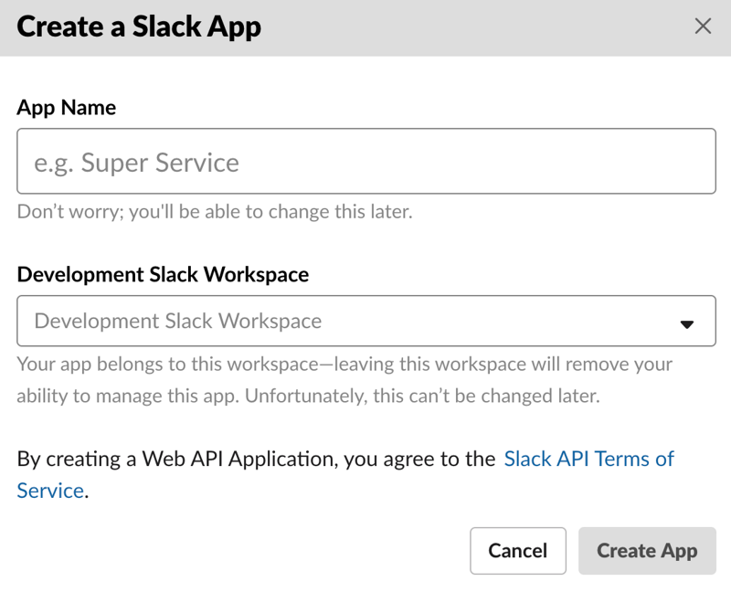

Slack Ruby Bot Server
=====================

[](https://badge.fury.io/rb/slack-ruby-bot-server)
[](https://github.com/slack-ruby/slack-ruby-bot-server/actions/workflows/test-mongodb.yml)
[](https://github.com/slack-ruby/slack-ruby-bot-server/actions/workflows/test-postgresql.yml)
[](https://github.com/slack-ruby/slack-ruby-bot-server/actions/workflows/rubocop.yml)

Build a complete Slack bot service with Slack button integration, in Ruby.

## Table of Contents

- [What is this?](#what-is-this)
- [Stable Release](#stable-release)
- [Make Your Own](#make-your-own)
- [Usage](#usage)
  - [Storage](#storage)
    - [MongoDB](#mongodb)
    - [ActiveRecord](#activerecord)
    - [Extending Team](#extending-team)
      - [Mongoid Attributes](#mongoid-attributes)
      - [Active Record Attributes](#active-record-attributes)
      - [Rails Loading and Reloading](#rails-loading-and-reloading)
  - [OAuth Version and Scopes](#oauth-version-and-scopes)
  - [Slack App](#slack-app)
  - [API](#api)
    - [Custom Endpoints](#custom-endpoints)
    - [Team Endpoint Visibility](#team-endpoint-visibility)
    - [App](#app)
    - [Service Manager](#service-manager)
      - [Lifecycle Callbacks](#lifecycle-callbacks)
      - [Service Timers](#service-timers)
      - [Extensions](#extensions)
    - [Service Class](#service-class)
  - [HTML Templates](#html-templates)
    - [Page Middleware Configuration](#page-middleware-configuration)
  - [Access Tokens](#access-tokens)
- [Testing](#testing)
- [Sample Bots Using Slack Ruby Bot Server](#sample-bots-using-slack-ruby-bot-server)
- [Copyright & License](#copyright--license)

## What is this?

A library that contains a web server and a RESTful [Grape](http://github.com/ruby-grape/grape) API serving a Slack bot to multiple teams. Use in conjunction with [slack-ruby-bot-server-events](https://github.com/slack-ruby/slack-ruby-bot-server-events) to build a complete Slack bot service. Your customers can use a Slack button to install the bot.

## Stable Release

You're reading the documentation for the **stable** release of slack-ruby-bot-server, 2.3.0. See [UPGRADING](UPGRADING.md) when upgrading from an older version. See [MIGRATING](MIGRATING.md) for help with migrating Legacy Slack Apps to Granular Scopes.

## Make Your Own

This library alone will only register a new bot, but will not include any bot functionality. To make something useful, we recommend you get started from either [slack-ruby-bot-server-events-app-mentions-sample](https://github.com/slack-ruby/slack-ruby-bot-server-events-app-mentions-sample) (handles a single kind of event), or [slack-ruby-bot-server-events-sample](https://github.com/slack-ruby/slack-ruby-bot-server-events-sample) (handles all kinds of events) to bootstrap your project.

## Usage

### Storage

A database is required to store teams.

#### MongoDB

Use MongoDB with [Mongoid](https://github.com/mongodb/mongoid) as ODM. Configure the database connection in `mongoid.yml`. Add the `mongoid` gem in your Gemfile.

```
gem 'mongoid'
gem 'kaminari-mongoid'
gem 'mongoid-scroll'
gem 'slack-ruby-bot-server'
```

#### ActiveRecord

Use ActiveRecord with, for example, PostgreSQL via [pg](https://github.com/ged/ruby-pg). Add the `activerecord`, `pg`, `otr-activerecord` and `pagy_cursor` gems to your Gemfile.
Currently supports ActiveRecord/Rails major versions 6.0, 6.1 and 7.0.

```
gem 'pg'
gem 'activerecord', require: 'active_record'
gem 'slack-ruby-bot-server'
gem 'otr-activerecord'
gem 'pagy_cursor'
```

Configure the database connection in `config/postgresql.yml`. 

```yaml
default: &default
  adapter: postgresql
  pool: 10
  timeout: 5000
  encoding: unicode

development:
  <<: *default
  database: bot_development

test:
  <<: *default
  database: bot_test

production:
  <<: *default
  database: bot
```

Establish a connection in your startup code.

```ruby
yml = ERB.new(File.read(File.expand_path('config/postgresql.yml', __dir__))).result
db_config = if Gem::Version.new(Psych::VERSION) >= Gem::Version.new('3.1.0.pre1')
              ::YAML.safe_load(yml, aliases: true)[ENV['RACK_ENV']]
            else
              ::YAML.safe_load(yml, [], [], true)[ENV['RACK_ENV']]
            end
ActiveRecord::Base.establish_connection(db_config)
```

#### Extending Team

The installation model is the top-level `::Team` class for both adapters, not `SlackRubyBotServer::Models::Team`. Load `slack-ruby-bot-server` before extending it. The model already includes its database adapter and timestamps; do not include them again or declare a different superclass.

##### Mongoid Attributes

Add fields by reopening the existing class in an application file, for example `lib/team_extensions.rb`:

```ruby
require 'slack-ruby-bot-server'

class Team
  field :subscription_plan, type: String, default: 'free'

  def paid_plan?
    subscription_plan == 'paid'
  end
end
```

Require that file from your startup code after loading the framework and before serving requests or starting the service. Mongoid does not require a schema migration for the new field.

##### Active Record Attributes

Add a column to the existing `teams` table with an application migration. Use your application's migration version; this example is also compatible with older supported Active Record versions:

```ruby
class AddSubscriptionPlanToTeams < ActiveRecord::Migration[6.0]
  def change
    add_column :teams, :subscription_plan, :string, default: 'free', null: false
  end
end
```

Run the migration before code uses the attribute. Active Record provides its reader and writer from the column; do not use `attr_accessor`, which would bypass persistence. Add methods by reopening `class Team` after loading the framework, as above, but omit the Mongoid-only `field` declaration.

##### Rails Loading and Reloading

Putting another `app/models/team.rb` in a Rails app is not a reliable way to extend a class already loaded by a gem. Put reloadable behavior in a concern instead:

```ruby
# app/models/concerns/team_extensions.rb
module TeamExtensions
  extend ActiveSupport::Concern

  def paid_plan?
    subscription_plan == 'paid'
  end
end
```

Include it in `::Team` from a reloader callback, rather than autoloading the concern directly during initializer execution:

```ruby
# config/initializers/team_extensions.rb
require 'slack-ruby-bot-server'

if SlackRubyBotServer.config.mongoid?
  ::Team.field :subscription_plan, type: String, default: 'free'
end

Rails.application.config.to_prepare do
  ::Team.include(TeamExtensions)
end
```

With Active Record, use the migration above instead of declaring a field in the initializer. The callback runs at boot and after development reloads; including the same concern more than once is safe. Keep one-time field declarations outside the callback. Do not query the database or swallow database errors just to attach methods: the extension can be loaded before the `teams` table exists.

The framework currently owns the global `Team` constant. An unrelated application model with the same name is a separate [name-collision limitation](https://github.com/slack-ruby/slack-ruby-bot-server/pull/83), not an extension mechanism.

### OAuth Version and Scopes

Configure your app's [OAuth version](https://api.slack.com/authentication/oauth-v2) and [scopes](https://api.slack.com/legacy/oauth-scopes) as needed by your application.

```ruby
SlackRubyBotServer.configure do |config|
  config.oauth_version = :v2
  config.oauth_scope = ['channels:read', 'chat:write']
end
```

The "Add to Slack" button uses the standard OAuth code grant flow as described in the [Slack docs](https://api.slack.com/docs/oauth#flow). Once clicked, the user is taken through the authorization process at Slack's site. Upon successful completion, a callback containing a temporary code is sent to the redirect URL you specified. The endpoint at that URL contains code that persists the bot token each time a Slack client is instantiated for the specific team.

### Slack App

Create a new Slack App [here](https://api.slack.com/applications/new).



Follow Slack's instructions, note the app client ID and secret, give the bot a default name, etc.

Within your application, edit your `.env` file and add `SLACK_CLIENT_ID=...` and `SLACK_CLIENT_SECRET=...` in it.

Run `bundle install` and `foreman start` to boot the app.

```
$ foreman start
07:44:47 web.1  | started with pid 59258
07:44:50 web.1  | * Listening on tcp://0.0.0.0:5000
```

Set the redirect URL in "OAuth & Permissions" be the location of your app. Since you cannot receive notifications on localhost from Slack use a public tunneling service such as [ngrok](https://ngrok.com/) to expose local port 9292 for testing.

```
$ ngrok http 5000
Forwarding https://ddfd97f80615.ngrok.io -> http://localhost:5000
```

Navigate to either [localhost:9292](http://localhost:9292) or the ngrok URL above. You should see an "Add to Slack" button. Use it to install the app into your own Slack team.

### API

This library implements an app, [SlackRubyBotServer::App](lib/slack-ruby-bot-server/app.rb) and a service manager, [SlackRubyBotServer::Service](lib/slack-ruby-bot-server/service.rb). It also provides [default HTML templates and JS scripts](public) for Slack integration.

#### Custom Endpoints

Set `config.api` to a Rack application, typically a `Grape::API` class, to customize the API without reopening the framework's classes. The default is `nil`, which uses `SlackRubyBotServer::Api::Endpoints::RootEndpoint`, including extensions mounted there by other gems. `SlackRubyBotServer::Config.reset!` restores this default.

To add an endpoint alongside the default API:

```ruby
class ExtraApi < Grape::API
  prefix 'api'
  format :json

  get :foobar do
    { ok: true }
  end
end

class ApplicationApi < Grape::API
  mount SlackRubyBotServer::Api::Endpoints::RootEndpoint
  mount ExtraApi
end

SlackRubyBotServer.configure do |config|
  config.api = ApplicationApi
end
```

Configure this before starting the application. In `config.ru`, continue running `SlackRubyBotServer::Api::Middleware.instance`; both `/api/foobar` and the existing `/api` routes then share the framework's CORS, URL-rewrite, and page middleware. A separate `Rack::Cascade` stack is unnecessary.

In Rails, require the file defining `ApplicationApi` from your initializer before assigning `config.api`. For reloadable classes, make the assignment inside `Rails.application.config.to_prepare` so it references the current class. Mount `SlackRubyBotServer::Api::Middleware.instance` in your routes, for example `mount SlackRubyBotServer::Api::Middleware.instance => '/'`, rather than bypassing that middleware stack.

#### Team Endpoint Visibility

The default API exposes `GET /api/teams` and `GET /api/teams/:id` publicly. To retain OAuth registration without those read endpoints, use the separately mountable `TeamsEndpoint::Create`. `TeamsEndpoint::Read` contains the list and detail routes; `TeamsEndpoint` continues to mount both for backward compatibility.

```ruby
class RegistrationApi < Grape::API
  include SlackRubyBotServer::Api::Helpers::ErrorHelpers

  prefix 'api'
  format :json
  formatter :json, Grape::Formatter::Roar

  mount SlackRubyBotServer::Api::Endpoints::TeamsEndpoint::Create
end

SlackRubyBotServer.configure do |config|
  config.api = RegistrationApi
end
```

This replaces the default root API: it does not expose its status, root discovery, Swagger, or team-read routes. Do not also mount `RootEndpoint` or `TeamsEndpoint`, since either would restore the public team reads. If you use the Events extension or other custom endpoints, explicitly mount their routes with their required signature verification too. Add your own authentication before mounting `TeamsEndpoint::Read` if you need protected team queries. OAuth registration still requires a valid Slack authorization code; this configuration does not add a general authentication layer.

#### App

The app instance checks for a working database connection, ensures indexes, performs migrations, sets up bot aliases and log levels. You can introduce custom behavior into the app lifecycle by subclassing `SlackRubyBotServer::App` and creating an instance of the child class in `config.ru`.

```ruby
class MyApp < SlackRubyBotServer::App
  def prepare!
    super
    deactivate_sleepy_teams!
  end

  private

  def deactivate_sleepy_teams!
    Team.active.each do |team|
      next unless team.sleepy?
      team.deactivate!
    end
  end
end
```

```ruby
MyApp.instance.prepare!
```

#### Service Manager

##### Lifecycle Callbacks

You can introduce custom behavior into the service lifecycle via callbacks. This can be useful when new team has been registered via the API or a team has been deactivated from Slack.

```ruby
instance = SlackRubyBotServer::Service.instance

instance.on :started, :stopped do |team|
  # team has been started or stopped
end

instance.on :created do |team, error, options|
  # a new team has been registered
end

instance.on :deactivated do |team, error, options|
  # an existing team has been deactivated in Slack
end

instance.on :error do |team, error, options|
  # an error has occurred
end
```

The following callbacks are supported. All callbacks receive a `team`, except `error`, which receives a `StandardError` object.

| callback       |  description                                                     |
|:--------------:|:-----------------------------------------------------------------|
| error          | an error has occurred                                            |
| creating       | a new team is being registered                                   |
| created        | a new team has been registered                                   |
| booting        | the service is starting and is connecting a team to Slack        |
| booted         | the service is starting and has connected a team to Slack        |
| stopping       | the service is about to disconnect a team from Slack             |
| stopped        | the service has disconnected a team from Slack                   |
| starting       | the service is (re)connecting a team to Slack                    |
| started        | the service has (re)connected a team to Slack                    |
| deactivating   | a team is being deactivated                                      |
| deactivated    | a team has been deactivated                                      |

The [Add to Slack button](https://api.slack.com/docs/slack-button) also allows for an optional `state` parameter that will be returned on completion of the request. The `creating` and `created` callbacks include an options hash where this value can be accessed (to check for forgery attacks for instance).
```ruby
auth = OpenSSL::HMAC.hexdigest("SHA256", "key", "data")
```
```html
<a href="<%= SlackRubyBotServer::Config.oauth_authorize_url %>?scope=<%= SlackRubyBotServer::Config.oauth_scope_s %>&client_id=<%= ENV['SLACK_CLIENT_ID'] %>&state=#{auth)"> ... </a>
```
```ruby
instance = SlackRubyBotServer::Service.instance
instance.on :creating do |team, error, options|
  raise "Unauthorized response" unless options[:state] == auth
end
```

##### Service Timers

You can introduce custom behavior into the service lifecycle on a timer. For example, check whether a team's trial has expired, or periodically clean-up data. Timers can run once on start (`once_and_every`) and start running after a certain period (`every`).

```ruby
instance = SlackRubyBotServer::Service.instance

instance.every :hour do
  Team.each do |team|
    begin
      # do something with every team once an hour
    rescue StandardError
    end
  end
end

instance.once_and_every :minute do
  # called once on start, then every minute
end

instance.every :minute do
  # called every minute
end

instance.every :second do
  # called every second
end

instance.every 30 do
  # called every 30 seconds
end
```

Note that, unlike callbacks, timers are global for the entire service. Timers are independent, and a failing timer will not terminate other timers.

##### Extensions

A number of extensions use service manager callbacks and service timers to implement useful functionality.

* [slack-ruby-bot-server-events](https://github.com/slack-ruby/slack-ruby-bot-server-events): Easily handle Slack slash commands, interactive buttons and events.
* [slack-ruby-bot-server-mailchimp](https://github.com/slack-ruby/slack-ruby-bot-server-mailchimp): Subscribes new bot users to a Mailchimp mailing list.
* [slack-ruby-bot-server-stripe](https://github.com/slack-ruby/slack-ruby-bot-server-stripe): Enables paid bots with trial periods and commerce through Stripe.

#### Service Class

You can override the service class to handle additional methods.

```ruby
class MyService < SlackRubyBotServer::Service
  def url
    'https://www.example.com'
  end
end

SlackRubyBotServer.configure do |config|
  config.service_class = MyService
end

SlackRubyBotServer::Service.instance # MyService
SlackRubyBotServer::Service.instance.url # https://www.example.com
```

### HTML Templates

This library provides a [default HTML template and JS scripts](public) that implement the "Add to Slack" button workflow. Customize your pages by adding a `public` directory in your application and starting with a [index.html.erb](public/index.html.erb) template. The application's `views` and `public` folders are [loaded by default](lib/slack-ruby-bot-server/api/middleware.rb#L32).

You can add to or override template paths as follows.

```ruby
SlackRubyBotServer.configure do |config|
  config.view_paths << File.expand_path(File.join(__dir__, 'public'))
end
```

#### Page Middleware Configuration

Use `config.server_pages` to configure the underlying [`Rack::ServerPages`](https://github.com/migrs/rack-server-pages) middleware in an initializer, before `SlackRubyBotServer::Api::Middleware.instance` is first accessed. The block receives its configuration object after the framework applies `view_paths`, so it can customize any option supported by your installed `rack-server-pages` version.

For example, with `rack-server-pages` 0.3.0 or newer:

```ruby
SlackRubyBotServer.configure do |config|
  config.server_pages do |pages|
    pages.cache_control = 'private, no-cache'
    pages.static_cache_control = 'public, no-cache'
  end
end
```

`cache_control` sets the default `Cache-Control` header for rendered templates, including generated CSS. `static_cache_control` sets it for static files. `no-cache` allows storage but requires revalidation before reuse; use `private, no-store` for sensitive pages. You can also configure `static_etags` and `static_timestamps` with version 0.3.0 or newer. These settings do not change downstream API responses.

Without a block, the framework preserves the installed library's defaults and existing `view_paths` behavior. Registering another block replaces the previous one, and `SlackRubyBotServer::Config.reset!` clears it. The block runs when the middleware stack is built, not on each request. If you change configuration after initialization, rebuild the stack with `SlackRubyBotServer::Api::Middleware.reset!`; configure it before startup in production.

### Access Tokens

By default the implementation of [Team](lib/slack-ruby-bot-server/models/team) stores the value of the token with all the requested OAuth scopes in both `token` and `activated_user_access_token` (for backwards compatibility), along with `oauth_version` and `oauth_scope`. If a legacy Slack bot integration `bot_access_token` is present, it is stored as `token`, and `activated_user_access_token` is the token that has all the requested OAuth scopes.

## Testing

The optional test helpers use [Fabrication](https://fabricationgem.org/) and Faker. Add `fabrication` and `faker` to your application's test dependencies; neither is a runtime dependency of this gem.

To use the framework's installation defaults without reserving your application's `:team` fabricator name, load the prefixed-only helper:

```ruby
require 'slack-ruby-bot-server/rspec/fabricators'

team = Fabricate(:slack_ruby_bot_server_team)
```

This fabricator creates the existing `::Team` model with unique token/team ID sequences and a generated name. Applications can register their own `:team` before or after this helper, or inherit the framework defaults:

```ruby
Fabricator(:team, from: :slack_ruby_bot_server_team) do
  name { 'My application team' }
end
```

The existing `require 'slack-ruby-bot-server/rspec'` remains supported. It loads the prefixed fabricator and registers the legacy `:team` alias only when no `:team` definition already exists. If your application defines `:team` later, replace the legacy require with `slack-ruby-bot-server/rspec/fabricators`; loading both entry points still opts into the legacy alias.

## Sample Bots Using Slack Ruby Bot Server

* [slack-ruby-bot-server-events-sample](https://github.com/slack-ruby/slack-ruby-bot-server-events-sample), a generic sample
* [slack-rails-bot-starter](https://github.com/CrazyOptimist/slack-rails-bot-starter), an all-in-one Rails starter kit
* [slack-sup2](https://github.com/dblock/slack-sup2), see [sup2.playplay.io](https://sup2.playplay.io)
* [slack-gamebot2](https://github.com/dblock/slack-gamebot2), see [gamebot2.playplay.io](https://gamebot2.playplay.io)
 
## Copyright & License

Copyright [Daniel Doubrovkine](http://code.dblock.org) and Contributors, 2015-2025

[MIT License](LICENSE)
